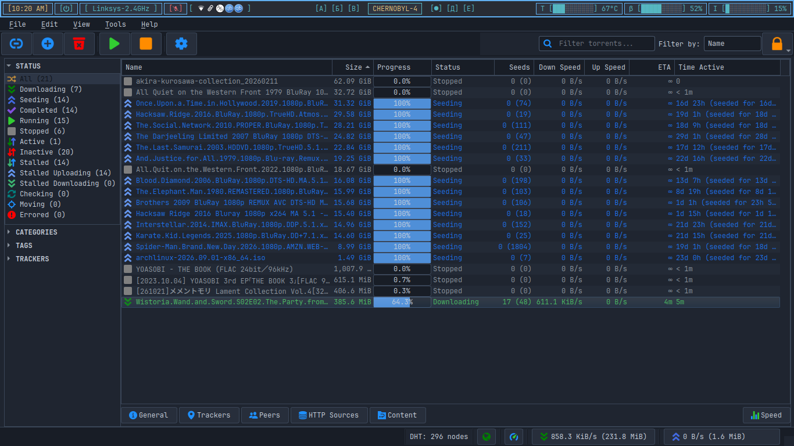

# fission-qbittorrent

A dark, blue-accented theme for the **qBittorrent desktop client**, with a Nord-inspired palette and JetBrains Mono everywhere.



## Palette

| Role            | Colour    |
|-----------------|-----------|
| Background      | `#1f2530` |
| Panels / header | `#181d26` |
| Raised / menus  | `#272e3b` |
| Hover           | `#2d3646` |
| Border          | `#3a4658` |
| Text            | `#c8d0dc` |
| Muted text      | `#7d889a` |
| Accent (blue)   | `#4f8fd8` |
| Seeding (cyan)  | `#56b6c2` |
| Warning (amber) | `#e8a23c` |
| Error           | `#e06c75` |

Transfer-list states are coloured too: downloading blue, seeding cyan, stalled and paused grey, checking amber, errors red.

## Install

1. Download the `.qbtheme` that matches your qBittorrent from the [Releases](../../releases) page:
   - `fission-qt6.qbtheme` for qBittorrent 4.6 and newer
   - `fission-qt5.qbtheme` for qBittorrent 4.3 to 4.5
2. In qBittorrent open **Tools → Options → Behavior → Interface**.
3. Tick **Use custom UI theme** and select the downloaded file.
4. Restart qBittorrent.

Not sure which Qt your build uses? Run `ldd $(which qbittorrent) | grep Qt`.

## Build from source

```
git clone https://github.com/ishtiaque-f/fission-qbittorrent.git
cd fission-qbittorrent
./build.sh
```

`build.sh` detects the Qt version your qBittorrent uses and runs the matching `rcc`. If `rcc` is missing:

```
sudo apt install qt6-base-dev-tools    # Qt6
sudo apt install qtbase5-dev-tools     # Qt5
```

The result is `fission.qbtheme` in the project folder.

## Customise

- `stylesheet.qss`: the Qt stylesheet for widgets, menus, tabs, scrollbars and buttons.
- `config.json`: qBittorrent-specific colours, including the transfer-list state colours.

Change the hex values, run `./build.sh`, and select the rebuilt file in the options.

## Notes

- This is for the desktop (Qt) client. It does not theme the web interface.
- A `.qbtheme` is built for one Qt version, so use the build that matches yours.
- If something looks off, open an issue with a screenshot and your qBittorrent version.

## Licence

MIT, see [LICENSE](LICENSE).
